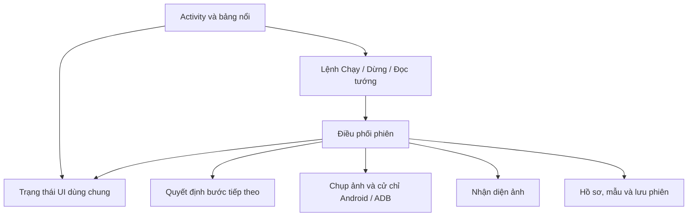

# Báo cáo nghiên cứu tối ưu AFK Auto

Ngày khảo sát: 09/11/2026. Phạm vi: ứng dụng Android 1.18, bộ nhận diện Kotlin/OpenCV, bản Python/ADB, kho mẫu, kiểm thử và quy trình phát hành.

**Khuyến nghị chính:** ưu tiên giảm công việc trên luồng giao diện, đơn giản hóa màn Tướng, làm rõ trạng thái bot và tách logic điều phối. Sau đó mới thử cải tiến nhận diện và chọn đội. Chưa có căn cứ để viết lại toàn bộ ứng dụng hoặc thay bộ nhận diện bằng mô hình AI lớn.

## 1. Cơ sở và giới hạn của báo cáo

Đã khảo sát mã hiện có trong thư mục làm việc, gồm cả thay đổi chưa commit; HEAD tham chiếu `22e76c7` không đại diện toàn bộ mã được khảo sát. Android khai báo phiên bản 1.18. Đã đọc UI XML, Activity, Service, bảng nổi, logic leo ải, mô-đun vision, các đường xử lý Python chính và tài liệu kiểm chứng. Đã xem ảnh UI lưu sẵn `debug/ho-so-mau-20261109/profile-120-restored.png`; đây là bằng chứng lịch sử, không phải ảnh chụp trực tiếp phiên hiện tại. Màu sắc trong ảnh có thể chịu ảnh hưởng hiển thị của máy, nên không dùng ảnh đó để kết luận độ tương phản của bản hiện hành.

Báo cáo phân biệt:

- **Xác định từ mã:** cấu trúc, đường gọi, thao tác đọc/ghi, kích thước nút, quy tắc thuật toán.
- **Rủi ro cần đo/tái hiện:** giật UI, mức tăng bộ nhớ, mất thời gian, lỗi trên Android/thiết bị khác.
- **Đề xuất thử nghiệm:** chưa được chứng minh nhanh hơn hoặc chính xác hơn trên ứng dụng này.

Không chạy bot điều khiển game trong đợt nghiên cứu này. Chưa đo FPS, pin, nhiệt, độ trễ chụp hay tốc độ Android thực tế. Không thay mã ứng dụng, bộ mẫu hoặc dữ liệu tài khoản. Kết quả kiểm thử chạy trong đợt khảo sát được ghi ở cuối báo cáo.

Tài liệu `docs/kiem-chung-1.18.md` xác nhận hiện chỉ có hai tài khoản phát triển và Tab S7; chưa đủ nguồn để khẳng định chất lượng trên tài khoản/thiết bị mới. Đối chiếu Python–Android chứng minh tính nhất quán, không tự chứng minh kết quả đúng. Những đề xuất cũ về tách hồ sơ và thu hồi mẫu đã có phần triển khai trong mã hiện tại, nên không coi chúng là chức năng còn thiếu.

## 2. Những phần nên giữ

- Mô-đun `vision` tách khỏi giao diện Android và có kiểm thử đối chiếu Python–Kotlin.
- Nhận diện đã thu nhỏ ảnh về rộng 800 px, tìm theo vùng và lưu kết quả tìm mẫu trong mỗi lượt. Không nên đề xuất lại các tối ưu này như việc mới.
- Bộ nhận diện giữ trạng thái **chưa rõ**, có kiểm tra chất lượng biên/sao, bảo vệ tập kiểm tra và lưu nguồn mẫu.
- Dữ liệu khung theo hồ sơ, mẫu tên dùng chung; có duyệt, thu hồi, phiên bản và khôi phục.
- Luồng đọc danh sách kiểm tra đầu/cuối, cuộn ngược, chồng lấp; ghi kết quả chính bằng `AtomicFile` và giữ dữ liệu cũ khi xác minh thất bại.
- Bot đã có chép nhanh đội đầu, tái dùng danh sách khi phù hợp và nhịp chờ riêng khi game đánh ngầm. Python/ADB đã thử cách chụp để chọn phương thức nhanh hơn.

Đây là các đặc tính cần được giữ bằng kiểm thử khi tái cấu trúc.

## 3. Các ưu tiên cụ thể

P1: nên làm trước; P2: làm sau khi có số đo nền; P3: thử nghiệm có điều kiện. Công sức S ≈ 0,5–2 ngày, M ≈ 3–5 ngày, L ≈ 1–2 tuần cho một người quen dự án, gồm kiểm tra cơ bản. Đây là ước lượng lập kế hoạch, không phải cam kết; các hạng mục có phần việc trùng nhau.

| Ưu tiên | Phát hiện và bằng chứng | Đề xuất | Lợi ích / công sức |
|---|---|---|---|
| P1 | `MainActivity.kt:178,277`: mỗi `onResume()` dựng lại toàn bộ mục Tướng, đọc JSON/ảnh dù đang ở tab khác | Nạp dữ liệu nền, chỉ mở dữ liệu cần cho tab, cập nhật theo thay đổi, dùng danh sách tái sử dụng hàng | UI phản hồi tốt hơn; M |
| P1 | `KhoMauAndroid.kt:43,87,95`: `localSamples()` gọi `status()` theo từng mẫu; mỗi lần lại gọi `current()` và đọc danh mục. `BoNhanDang.load()` kiểm mã nội dung tệp | Một snapshot kho đã kiểm chứng cho mỗi tác vụ; lập bảng trạng thái mẫu một lần | Tránh đọc/hash lặp và quét danh mục gần bậc hai theo số mẫu cá nhân; M |
| P1 | `Leo.kt:160,888`: `bam()` bỏ qua Boolean từ `svc.tap()`, `chep()` vẫn cập nhật đội đã chép sau lời gọi đó | Kết quả thao tác có kiểu; chỉ cập nhật trạng thái sau bằng chứng thành công trên màn tiếp theo | Giảm lệch trạng thái khi cử chỉ bị hủy; M |
| P1 | `Status.kt`, `MainActivity.askNotifications()`: kiểm/xin `POST_NOTIFICATIONS` không rẽ nhánh API, trong khi minSdk 30 | Chỉ xin quyền này từ API 33; máy cũ kiểm trạng thái thông báo phù hợp | Sửa đường tương thích Android 11–12; S |
| P1 | `Overlay.kt:76–85,132`: nút mở rộng/đóng cao 24dp; nút đóng rộng 28dp | Tăng vùng chạm, tách đóng khỏi thao tác thường dùng, giữ Dừng dễ thấy | Giảm bấm nhầm; S |
| P1 | `MainActivity.kt:416`: sửa khung chỉ có Có/Không/Chưa có, không có đường trả về tự đọc | Thêm “Dùng kết quả tự đọc”, hiển thị nguồn và lần cập nhật | Tránh lựa chọn tay cũ tiếp tục lấn át kết quả mới; S |
| P2 | `Leo.kt` 1.293 dòng chứa vòng chạy, chọn đội, đọc danh sách, lưu ảnh và dữ liệu | Tách bộ quyết định, hành động, nhận diện, lưu phiên theo trách nhiệm | Dễ đọc, kiểm thử và tái dùng; L |
| P2 | `Leo.kt:1241–1264`: ghi nhiều PNG/JSON và ứng viên sau đoạn CPU, quay về ngữ cảnh gọi từ Main | Đưa lưu phiên sang tác vụ nền có vòng đời rõ, vẫn commit kết quả nguyên tử | Giảm nguy cơ đứng giao diện khi đọc xong; M |
| P2 | `BotService.saveImage()` clone ảnh trước khi xếp tác vụ; giải phóng không nằm trong `finally`; `Leo.chup()` không thu hồi ảnh nếu nhận diện ném lỗi | Quy ước sở hữu ảnh, `try/finally`, hàng đợi ghi ảnh có giới hạn | Giảm rủi ro giữ bộ nhớ native khi lỗi/hủy; M |
| P2 | `vision-sessions` và thư mục ảnh tướng theo phiên được thêm liên tục; giới hạn 100 ảnh chỉ áp dụng `debug/` | Chính sách lưu phiên theo dung lượng, tham chiếu và trạng thái bảo vệ | Kiểm soát bộ nhớ lưu trữ; M |
| P2 | `AppLog` phát sự kiện mỗi dòng; Activity dựng lại 200 dòng dù tab nhật ký bị ẩn | Chỉ quan sát khi cần, gộp cập nhật theo khoảng ngắn, lọc theo phiên/mức lỗi | Giảm cập nhật UI và dễ tra lỗi; S |
| P2 | `requirements.txt` không khóa phiên bản; JVM dùng OpenCV 4.9, Android 4.12 | Ghim môi trường đã kiểm, ghi phiên bản runtime vào báo cáo và duy trì kiểm thử thiết bị | Kết quả dễ tái lập hơn; M |
| P3 | Release tắt minify; APK 1.18 khoảng 34,1 MB dạng thập phân | Thử R8 trên nhánh riêng, kiểm JNI/OpenCV và so kích thước APK | Có thể giảm phần mã/resources; S–M |

Riêng lỗi cử chỉ: callback thành công chỉ chứng minh Android thực hiện cử chỉ, chưa chứng minh game đã chép đội. Cần kiểm tra hậu điều kiện như trở về đội hình, lực chiến/đội thay đổi phù hợp, với giới hạn thử lại. Chưa tái hiện lỗi này trên máy trong đợt khảo sát.

Quyền thông báo thời gian chạy được Android quy định từ API 33; cần kiểm tra riêng bật/tắt thông báo và channel trên các phiên bản hỗ trợ. [Tài liệu Android](https://developer.android.com/develop/ui/compose/notifications/notification-permission).

## 4. UI: đơn giản hơn theo công việc thực tế

### 4.1 Cấu trúc đề xuất

Giữ bốn mục quen thuộc nhưng đổi trọng tâm: **Chạy · Tướng · Lịch sử · Cài đặt**. Không tăng thêm tab chính.

| Màn | Nội dung ưu tiên | Nội dung chuyển vào chi tiết |
|---|---|---|
| Chạy | Hồ sơ đang dùng; sẵn sàng/chờ/lỗi; chế độ; nút Chạy/Dừng; tiến trình phiên | Hướng dẫn cài đặt đã hoàn thành; quy tắc chọn đội nâng cao |
| Tướng | Hồ sơ; lần đọc gần nhất; tổng số; số cần xác nhận; tìm kiếm/lọc; Đọc lại | Duyệt mẫu, phiên bản, khôi phục, bằng chứng nhận diện |
| Lịch sử | Phiên gần nhất, lý do dừng, ải qua, thời gian, lỗi cần xử lý | Log kỹ thuật và ảnh gốc |
| Cài đặt | Giới hạn chạy và tùy chọn thường dùng | Chẩn đoán, số lần thử, ngưỡng và thông tin lưu trữ |

Hiện màn Tướng đặt giải thích dài và hàng chờ duyệt mẫu trước danh sách. Ảnh UI lưu sẵn cho thấy người dùng phải đi qua nhiều nội dung mới thấy các tướng. Nên đưa phần “Cần xác nhận” và kết quả đọc lên trước; hàng chờ mẫu mở bằng một nút có số lượng.

Bố cục màn Chạy dự kiến:

```text
AFK Auto                       [Tài khoản đang dùng ▾]
Sẵn sàng / Đang chạy / Cần bạn xử lý
Huyền Linh · Ải … · Đã qua … ải trong phiên

[              Chạy / Dừng              ]
Chế độ: Cả hai / AFK / Huyền Linh
Leo hộ: Tắt        Tự động chiến đấu: Bật
Dừng sau: Không giới hạn                 [Sửa]

Thiết lập: Đã sẵn sàng                   [Chi tiết]
```

Khi chưa cấp Trợ năng, thay vùng hành động bằng bước cần làm tiếp. Khi đã đủ thiết lập, thu gọn hướng dẫn. Thiếu thông báo cần được diễn đạt đúng: bot có thể chạy nhưng người dùng có thể không nhận được cảnh báo; không trình bày như cùng mức với thiếu Trợ năng.

### 4.2 Màn Tướng và sửa kết quả

- Dòng tổng quan phải tách **chưa rõ tên** khỏi **chưa rõ khung**. Hiện số “chưa rõ” đếm đối tượng không có `ten`, dễ bị hiểu thành toàn bộ kết quả chưa chắc.
- Bộ lọc: “Cần xác nhận”, “Quan trọng cho leo ải”, “Tất cả đã đọc”. Danh sách hiện tại lấy `quanTrong()`, nên tổng số đã đọc không đồng nghĩa mọi tướng đều xuất hiện trong danh sách sửa.
- Mỗi hàng chỉ hiện ảnh, tên, khung đang dùng và nguồn “Tự đọc / Bạn chọn”. Chạm hàng mở chi tiết và ứng viên ảnh; nút “Xem ảnh khác” dễ hiểu hơn hành vi ẩn khi chạm ảnh.
- Tách “Chưa sở hữu” với “Chưa xác định”. Thêm “Dùng kết quả tự đọc” để xóa ghi đè tay, không đổi nó thành không khung.
- Tách sửa hồ sơ khỏi bổ sung mẫu dùng chung. Trước khi duyệt mẫu, hiển thị tên gán và ảnh đủ lớn; không tự duyệt hàng loạt chỉ để giảm số lần chạm.
- Nhớ tab, bộ lọc, vị trí cuộn khi Activity được tạo lại. Hiện `selectPage(0)` luôn đưa về tab đầu trong `onCreate()`.

### 4.3 Bảng nổi và khả năng sử dụng

Bảng thu gọn chỉ cần trạng thái ngắn, Chạy/Dừng và mở rộng. Đóng bảng chuyển vào phần mở rộng; để hành động Dừng luôn trực tiếp. Đồng bộ chế độ với app: bảng nổi hiện chỉ có “Cả hai” và “Ải AFK”, trong khi app còn có “Chỉ Huyền Linh”.

Tăng vùng chạm tối thiểu khoảng 48×48dp, có thể giữ biểu tượng nhỏ bên trong; vùng mở rộng không được chồng lấn gây bấm nhầm. Thử chữ hệ thống lớn, TalkBack và màn hình hẹp; không chỉ xét Tab S7. [Hướng dẫn accessibility Android](https://developer.android.com/guide/topics/ui/accessibility/views/apps-views?hl=en).

Mục tiêu UX đề xuất để nghiệm thu: sau thiết lập, bắt đầu/dừng trong 1–2 thao tác; tìm và sửa một tướng trong tối đa 3 thao tác sau khi vào mục Tướng; lý do chờ/dừng luôn nhìn thấy mà không cần đọc log. Các chỉ tiêu này là mục tiêu thiết kế, chưa đo người dùng thực tế.

## 5. Code: tách nhỏ theo trách nhiệm, tránh thêm tầng không cần thiết

Cấu trúc mục tiêu:



**Thứ tự tách:** `TeamSelectionPolicy` trước vì phần quyết định nhỏ và có thể đối chiếu Python; tiếp theo `HeroScanSession`, `HeroRepository`/`SampleRepository`; cuối cùng tách các trạng thái leo ải còn lại. Không chuyển toàn bộ sang kiến trúc mới trong một lần.

- UI chỉ hiển thị dữ liệu và phát lệnh. Một mô hình trạng thái dùng chung cho Activity, bảng nổi và thông báo; không lấy chuỗi `BotStatus.text` làm dữ liệu nghiệp vụ. Dùng ViewModel cho trạng thái màn hình và state holder sống theo Service cho phiên bot. Đây phù hợp khuyến nghị luồng dữ liệu một chiều của Android. [Khuyến nghị kiến trúc](https://developer.android.com/topic/architecture/recommendations?hl=en).
- Đưa trạng thái màn hình/chế độ/quyết định thành enum hoặc sealed type; giữ tên JSON hiện hành bằng bộ chuyển đổi để không phá dữ liệu cũ. Thay các số `-1`, `-3` ở lớp nghiệp vụ bằng trạng thái rõ nghĩa.
- Quyết định thuần nhận `state + observation + config`, trả `nextState + action`. Đồng hồ và giao diện thiết bị có thể thay bằng bản giả trong kiểm thử. Không để hàm chọn đội trực tiếp chụp, bấm hoặc ghi tệp.
- Cố định cấu hình của phiên và quy định tùy chọn nào được đổi khi đang chạy. Hiện có tùy chọn đọc lúc bắt đầu, tùy chọn đọc mỗi quyết định; cần thể hiện rõ trong UI.
- Thao tác tệp chạy nền; tác vụ CPU xử lý ảnh chạy nền; cập nhật View chạy Main. Đưa dispatcher vào constructor khi cần kiểm thử. `suspend` tự nó không chuyển tác vụ khỏi Main. [Thực hành coroutine Android](https://developer.android.com/kotlin/coroutines/coroutines-best-practices).
- Định dạng lại các hàm Kotlin/Python viết dồn nhiều câu một dòng, dùng tên giải thích ý nghĩa, trích ngưỡng có đơn vị và lý do. Không đổi tên mọi API hoặc dịch toàn bộ tên tiếng Việt chỉ vì phong cách.
- Python nên có package lõi `vision`, `automation`, `datasets`, `reports`; các script gốc làm wrapper CLI tương thích. Giữ Python làm công cụ nghiên cứu và Android làm runtime; chia sẻ schema, bộ mẫu, fixture và đặc tả hành vi, không nhúng Python vào Android chỉ để giảm trùng mã.

Với danh sách Tướng, có thể tiếp tục dùng XML/Views và chuyển sang RecyclerView; chưa cần chuyển sang Compose để đạt lợi ích chính. RecyclerView tái sử dụng hàng khi cuộn. [Tài liệu RecyclerView](https://developer.android.com/develop/ui/views/layout/recyclerview?hl=en).

### Cache, bộ nhớ và lưu trữ

Snapshot kho mẫu cần bất biến và gắn phiên bản. Kiểm chứng đầy đủ khi nạp/kích hoạt/cập nhật/khôi phục; sau thay đổi, hủy snapshot cũ và thông báo UI. Không cache theo tên tệp rồi bỏ qua mã nội dung, và không cho phiên đang chạy lẫn hai phiên bản mẫu.

Quy định hàm nào sở hữu `Mat`, hàm nào chỉ mượn; cleanup trong `finally` cả khi exception/cancellation. Xem thêm đường nhận screenshot bị hủy sau callback, nạp mẫu trong `onServiceConnected()` và giải phóng mẫu khi Service dừng. Đây là các điểm cần fault injection/đo native memory, chưa phải kết luận có rò rỉ quan sát được.

Lưu ảnh chẩn đoán qua một hàng đợi giới hạn. Ảnh phục vụ kết quả cần ghi đủ và xác minh trước commit; ảnh debug có thể bỏ bớt khi quá tải. Quota dọn dẹp chỉ xóa phiên không còn được kết quả/hồ sơ/mẫu tham chiếu. Không xóa bộ kiểm chứng được bảo vệ. Cho người dùng xem dung lượng và xuất gói hỗ trợ.

## 6. Thuật toán: hướng nào đáng thử?

### A. Chờ theo trạng thái và nhận diện có ngữ cảnh — ưu tiên cao

Hiện có nhiều khoảng chờ cố định: sau bấm 1.500ms, chuyển đội 1.200ms, chiến đấu 3.000ms, đánh ngầm 20.000ms. Có thể thử `waitUntil`: chờ tối thiểu cho hoạt ảnh, dò vùng nhỏ của màn mong đợi, xác nhận ổn định qua hai lần đọc, tăng khoảng dò dần và kết thúc bằng deadline.

Lợi ích kỳ vọng là giảm thời gian chờ thừa hoặc bấm trước khi máy chậm hoàn tất. Rủi ro là tăng số lần chụp, CPU và pin; vì vậy không thay mọi `delay` bằng polling nhanh. Giữ nhịp chậm khi đánh ngầm. Đo tổng thời gian, số screenshot và tỷ lệ thao tác phải làm lại.

Nhận diện có thể thử màn dự kiến từ trạng thái trước, nhưng phải kiểm tra lớp phủ/kết quả ưu tiên và fallback sang bộ đầy đủ khi không chắc. Hiện `NhanDien` đã cache phép so trong một ảnh; cải tiến mới nằm ở chọn tập mẫu cần thử giữa các trạng thái. Template matching vẫn phù hợp khi hình dạng UI ổn định. [Cơ chế OpenCV matchTemplate](https://docs.opencv.org/doc/doxygen/html/d4/dc6/tutorial_py_template_matching.html).

### B. Tái dùng mẫu nhiều tỷ lệ — dễ thử, rủi ro tương đối thấp

`saoDaTyLe()` đang resize mẫu trong từng lần đánh giá thẻ, qua tám tỷ lệ. Chuẩn bị sẵn các mẫu này theo phiên bản rồi dùng lại; chỉ giải phóng khi thay bộ mẫu. Đo thời gian mỗi thẻ và bộ nhớ tăng; bắt buộc kết quả điểm/ngưỡng tương đương trong sai số đã chấp thuận.

`KhungV2.predict()` chỉ cần ba khoảng cách nhỏ nhất mỗi lớp nhưng đang sort toàn bộ. Có thể dùng bộ giữ top-3, đổi từ O(M log M) xuống O(M) cho M mẫu. Với khoảng 29 mẫu học ghi trong tài liệu, lợi ích có thể rất nhỏ; xếp sau việc bỏ đọc tệp lặp.

### C. Gom thẻ qua nhiều trang — ưu tiên độ đúng trước tốc độ

`DocDanhSach.themV2()` so mỗi thẻ với tất cả thẻ đã biết rồi lấy giống nhất. Khi số thẻ tăng, tổng so sánh tăng gần bậc hai; ảnh mặt gần giống nhau có thể khiến gộp sai dù tổng số cuối nhìn hợp lý.

Thử ghép thẻ trong vùng chồng lấp theo thứ tự hàng/cột và ước lượng quãng cuộn, sau đó xác nhận bằng ảnh mặt. Thẻ ngoài vùng dự kiến mới tìm toàn cục. Phải giữ dự phòng khi cuộn ngược/bỏ bước, tách nhóm cố định trên đầu và không dùng vị trí làm bằng chứng duy nhất.

Thước đo: bỏ sót, gộp nhầm, đếm trùng, tên sai, số lần so ảnh và thời gian phiên. “Đủ 120” không đủ chứng minh đúng 120 danh tính.

### D. Ghép tên toàn cục — chỉ thử offline

Hiện gán tên theo điểm và ràng buộc một tên/một thẻ; V2 chỉ xét ứng viên đầu khi yêu cầu chênh lệch điểm. Bài toán ghép cặp tối ưu có thể cân nhắc cả danh sách để giải quyết xung đột tên. Có thể dùng linear assignment ở bản nghiên cứu Python. [Tài liệu SciPy](https://docs.scipy.org/doc/scipy/reference/generated/scipy.optimize.linear_sum_assignment.html).

Tuy nhiên tối đa tổng điểm không đồng nghĩa ít nhận sai hơn. Cần thêm lựa chọn “không gán”, cấm cặp dưới ngưỡng, giữ điều kiện chênh lệch và xử lý thẻ trùng trước khi ghép. Không ép thẻ về tên thứ hai chỉ vì tên đầu đã dùng: dự án đã có kiểm thử ngăn hành vi đó. Ví dụ ma trận điểm nhỏ chỉ chứng minh tối ưu tổng điểm, không chứng minh đúng danh tính.

Chỉ đưa vào app nếu tăng số tên đúng trên nguồn độc lập mà không tăng tên sai; nếu chỉ đổi “chưa rõ” thành câu trả lời rủi ro thì giữ thuật toán hiện tại.

### E. Chọn đội theo hiệu quả thời gian — sau khi chuẩn hóa dữ liệu

Quy tắc hiện tại đã tận dụng thứ tự của game, khung và tỷ lệ lực chiến. Các thống kê như 42% thắng trận đầu hay tỷ lệ thấp ở lần thử sau trong README là dữ liệu lịch sử mẫu nhỏ, chưa đủ kết luận cho mọi mùa/chế độ/tài khoản.

Thử mô hình đơn giản, dễ giải thích: ước lượng xác suất thắng có làm trơn theo tỷ lệ lực chiến, thiếu khung, thứ hạng game, số lần thất bại và chế độ. Xếp hạng theo:

`điểm = xác suất thắng ước lượng / (thời gian tới đội + thời gian chép + thời gian trận)`

Đây là heuristic một bước; không phải lời giải tối ưu toàn bộ phiên. Đội đứng xa có thể không đáng chép dù mạnh hơn một chút. Ghi thêm hồ sơ, mùa/phiên bản game, phiên bản chính sách và thời gian từng pha vào dữ liệu trận. Chia tập theo phiên/thời gian/tài khoản để tránh trộn các trận cùng ải.

Log cũ chỉ có kết quả đội đã chọn, không có kết quả đội chưa đánh. Vì vậy đánh giá offline không chứng minh chính sách mới thắng chính sách cũ; cần chạy quan sát đề xuất trước, rồi so phiên thực có điều kiện tương đương. Chưa nên dùng reinforcement learning hay bandit tự khám phá khi dữ liệu và ngân sách thử còn ít.

### F. Mô hình ảnh học sâu / ANN — chưa ưu tiên

Embedding, detector hoặc tìm lân cận xấp xỉ có thể phù hợp khi nhiều thiết bị/diện mạo và kho mẫu lớn. Hiện chi phí dữ liệu, hiệu chỉnh ngưỡng, runtime và bảo trì chưa được bù bằng bằng chứng lợi ích. Giữ OpenCV và tối ưu đường dữ liệu trước; chỉ nghiên cứu mô hình mới khi đã xác định nhóm lỗi mà mẫu ảnh không giải quyết được.

## 7. Đo lường và kiểm thử để xác nhận hiệu quả

Ghi số đo nền trên cùng APK, bộ mẫu, hồ sơ và thiết bị; giữ trạng thái nhiệt/nguồn điện tương đương. Tách thời gian chụp, nhận diện, quyết định, chờ game, ghi dữ liệu. Báo median và p95, không chỉ trung bình.

| Nhóm | Chỉ số cần thu | Điều kiện chấp nhận đề xuất |
|---|---|---|
| UI | Thời gian mở app/mục Tướng, frame chậm, số lần đọc kho | Mục tiêu giảm p95 mở mục Tướng ≥30% nếu số đo nền xác nhận nghẽn; không mất trạng thái khi quay lại |
| Bot | Thời gian qua ải, số chép, thao tác thất bại, screenshot/phút | Cải thiện thời gian trong phiên tương đương, không tăng lỗi thao tác |
| Ảnh | Thời gian/thẻ, số phép so, heap/native memory | Điểm/kết quả hồi quy không đổi với tối ưu thuần hiệu năng; bộ nhớ không tăng dần qua phiên lặp |
| Độ đúng | Đúng/sai/chưa rõ tách tên và khung; bỏ sót/trùng | Không tăng lỗi trên bộ đánh giá cố định; báo cả độ phủ, không giấu số chưa rõ |
| Pin/lưu trữ | Pin/giờ, nhiệt, ảnh/phiên, tổng dung lượng | Có quota, không xóa dữ liệu tham chiếu; pin không xấu đi rõ rệt |

Dùng Macrobenchmark cho tương tác mở/cuộn UI; thêm đo riêng cho xử lý ảnh và phiên bot. Thư viện benchmark giúp tái lập điều kiện tốt hơn phép đo thủ công đơn lẻ. [Hướng dẫn Android](https://developer.android.com/topic/performance/benchmarking/benchmarking-overview).

Ca kiểm thử cần bổ sung khi triển khai: cử chỉ trả false, screenshot timeout/hủy, lưu ảnh lỗi/hết dung lượng, đổi hồ sơ, duyệt/thu hồi/rollback mẫu, dừng giữa phiên, Service khởi động lại, font lớn, Android 11/12/13+, ảnh của máy khác. Thêm bộ kiểm thử quyết định leo ải Kotlin: Python có `test_leo_ai.py` nhưng không thay thế việc xác minh logic Android sau khi hai bản thay đổi riêng.

## 8. Tái lập và phát hành

- Gói bộ fixture tối thiểu có manifest/hash và nguồn hợp lệ để người khác chạy kiểm thử; tách dữ liệu cá nhân lớn ngoài Git. Hiện nhiều kiểm thử/báo cáo dựa vào `debug/` và dữ liệu cục bộ.
- Khóa phiên bản Python đã chạy tốt, ghi phiên bản OpenCV hai runtime, đưa lint/format và kiểm thử vào quy trình phát hành.
- Cập nhật README: phần mở đầu vẫn mô tả “bản hiện tại là bản máy tính”, trong khi đã có Android 1.18; một số mô tả “chưa chuyển Android” cần đối chiếu mã mới. Tách hướng dẫn người dùng, phát triển và nhật ký nghiên cứu.
- Thử R8 và resource shrinking có kiểm tra release/JNI; lưu mapping để tra crash. Không dự báo giảm phần trăm APK khi chưa phân tích các thư viện native và assets. [Tài liệu R8](https://developer.android.com/topic/performance/app-optimization/enable-app-optimization).
- `phatHanh` đã chặn thiếu khóa ký, nhưng `assembleRelease` còn fallback ký debug. Nên làm rõ bản nội bộ và bản phân phối, bảo đảm đường phát hành chính thức luôn kiểm khóa, kiểm thử và ghi manifest APK/mẫu.

## 9. Lộ trình khuyến nghị

| Giai đoạn | Phạm vi | Cổng hoàn thành |
|---|---|---|
| 1 — sửa nền, khoảng 3–5 ngày | Đo nền; snapshot kho; I/O nền; quyền thông báo theo API; trạng thái lỗi thao tác | UI không đọc lặp theo hàng; test thao tác thất bại; có số đo trước/sau |
| 2 — đơn giản hóa UI, khoảng 3–5 ngày | Màn Chạy/Tướng; tìm/lọc; reset khung tay; vùng chạm overlay; nhớ trạng thái | Thử luồng chính và font lớn; người dùng tìm/sửa được tướng và biết bot đang chờ gì |
| 3 — cấu trúc và độ bền, khoảng 1–2 tuần | Tách policy/scan/repository; kiểu trạng thái; quản lý Mat; quota phiên; kiểm thử Kotlin | Logic tương đương; dừng/lỗi không làm hỏng dữ liệu; không tăng bộ nhớ qua phiên lặp |
| 4 — thử thuật toán, khoảng 1–2 tuần tùy dữ liệu | Cache mẫu tỷ lệ; chờ theo trạng thái; ghép trang; đánh giá ghép tên/chọn đội | Có đối chiếu độc lập, giữ rollback; chỉ nhận thay đổi có lợi ích đo được |

Có thể làm UI và tách một số lớp đan xen; không cộng cơ học mọi ước lượng trong bảng ưu tiên. Nguồn ảnh/thiết bị độc lập là điều kiện cho giai đoạn đánh giá độ đúng, không cản trở các cải tiến UI và cấu trúc.

**Ba việc tôi đề xuất bắt đầu:** (1) bỏ đọc/hash/dựng lại dữ liệu Tướng trên Main, (2) rút gọn màn Tướng với bộ lọc và đường quay về tự đọc, (3) kiểm chứng thao tác trước khi đổi trạng thái bot. Đây là nhóm thay đổi có bằng chứng trực tiếp từ mã và lợi ích thực dụng nhất.

## 10. Kết quả kiểm tra trong đợt khảo sát

- Đã chạy `.venv/bin/python -m unittest discover -v`: **170 kiểm thử đạt**, thời gian báo cáo **152,598 giây**, không có lỗi. Đây là bộ unittest được discovery tìm thấy trong môi trường/dữ liệu hiện tại; không bao gồm kiểm thử Android trên thiết bị.
- Đã thử `./gradlew :vision:test --offline --console=plain`: **chưa chạy được kiểm thử Kotlin**. Gradle Wrapper không tạo được tệp khóa trong `/home/hoangkhanh/.gradle/wrapper/dists/...` do thư mục chỉ đọc. Đây là giới hạn môi trường thực thi, không phải kiểm thử sản phẩm thất bại. Không dùng kết quả build cũ để thay cho lần chạy này.
- Chưa chạy kiểm thử tương tác trên điện thoại, benchmark hiệu năng hay đo độ chính xác bằng nguồn mới. Các tỷ lệ cải thiện trong báo cáo là mục tiêu nghiệm thu hoặc giả thuyết, không phải kết quả đạt được.
- Nhật ký của đợt khảo sát nằm tại `/tmp/afk-audit-python-tests.log` và `/tmp/afk-audit-kotlin-tests.log` trong phiên làm việc này.

